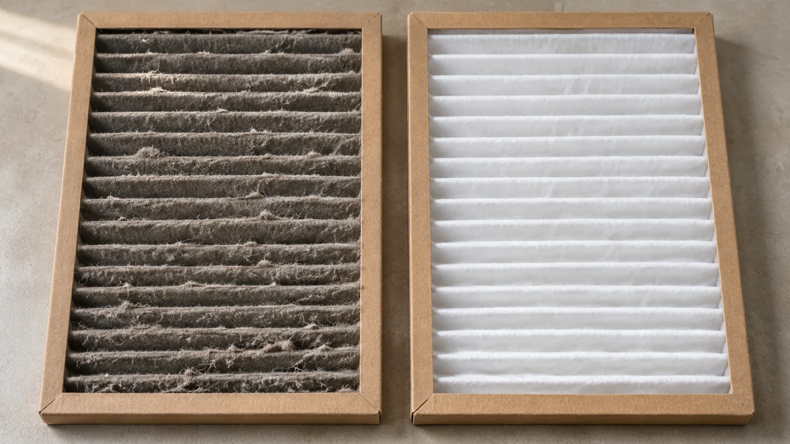
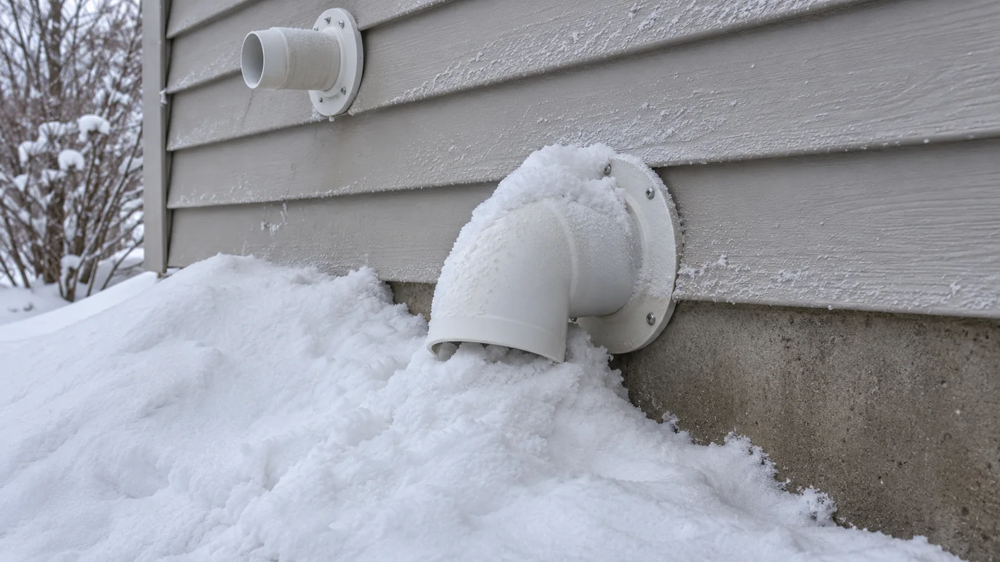
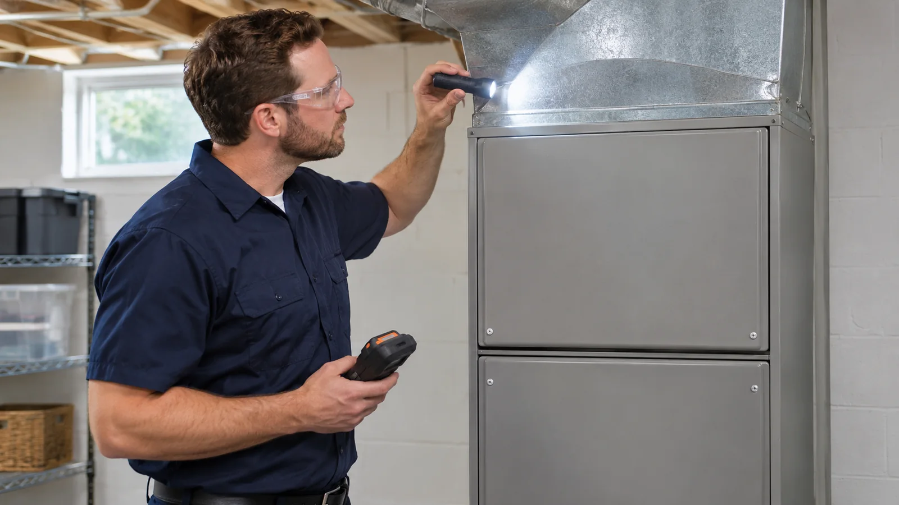

# Why Is My Furnace Not Heating? 7 Common Problems and When to Call a Professional

By Apex Home Services

**DRAFT — not published. 1795 words; 9 minute estimate.**

Understand seven possible causes of a furnace not heating, the checks homeowners can safely make, and the warning signs that need professional or emergency help.

A furnace not heating raises a question: is there a setting to check, or does the system need service? The answer depends on its behavior and warning signs. A running fan does not necessarily mean the furnace is producing heat.

For homeowners in New York, New Jersey, Connecticut, Massachusetts, and Rhode Island, this guide covers forced-air furnace troubleshooting. Boilers, heat pumps, and other heating systems need different checks.

> **Check for danger before troubleshooting**
>
> If a carbon monoxide alarm sounds, or you suspect carbon monoxide exposure, get everyone outside immediately and call 911. If you smell gas or suspect a gas leak, leave immediately; call 911 or your gas utility from a safe location outside. Do not operate switches, thermostats, plugs, or phones inside, and avoid flames. Do not reenter until emergency responders say it is safe. Skip every troubleshooting step below in these situations.

## How does a furnace heat your home?

The thermostat requests heat, the furnace generates it, and a blower moves warmed air through ducts. Return ducts bring room air back to the system. In a gas furnace, combustion heats a heat exchanger, which transfers warmth to the circulating air while keeping combustion gases separate and venting them outdoors. Gas equipment still needs electricity for controls and airflow.

Oil furnaces use a different burner and fuel-delivery arrangement. Electric furnaces use resistance elements rather than a gas burner or pilot. Older gas models may have a standing pilot; many newer models use electronic ignition. Identify your equipment from its accessible label and owner's manual before assuming a particular component is present.

## Seven common reasons your furnace is not heating

### 1. Thermostat settings or a thermostat fault

Confirm Heat mode and a set temperature above room temperature. Check schedules, vacation settings, and user-replaceable batteries. Follow the manual and allow for its normal startup delay.

A fan set to On can circulate room-temperature air between heating cycles. Auto normally runs it with the system's heating cycle. If the display stays blank or the furnace does not respond, a thermostat, wiring, or control problem may need diagnosis. Do not remove wiring or jumper terminals.

### 2. A dirty or incorrectly fitted air filter

A clogged filter restricts airflow, as explained in the [U.S. Department of Energy's filter guidance](https://bsesc.energy.gov/energy-basics/hvac-proper-installation-filters). Some furnaces then overheat and shut off heat through a safety control. A clean filter does not rule out other airflow problems.

Inspect or replace a filter only if the owner's manual identifies it as homeowner-accessible. Follow the manual's shutdown instructions, use the specified size and type, and match the airflow arrow. Do not run without a filter or open burner or electrical compartments. If heat does not return, arrange service instead of repeatedly restarting the system.

AI-generated comparison. Use the filter size and type specified for your system.

### 3. A power interruption or tripped circuit breaker

Gas and oil furnaces also need electricity. Check household power and utility outage notices. You may observe a clearly labeled furnace service switch or breaker from a safe position without removing covers.

Do not reset a tripped breaker as part of this guide: it may indicate an electrical fault. Leave an unexpectedly off switch alone if you do not know why it was turned off. A qualified professional should investigate. Never touch electrical equipment that is wet, damaged, sparking, or unusually hot.

### 4. Ignition, pilot, or flame-detection problems

A gas furnace may start but fail to establish or maintain a flame. Depending on the model, an electronic igniter, standing pilot, or flame-sensing component could be involved. Electric furnaces do not have these combustion parts.

Repeated clicking or short starts are observations to report, not a reliable diagnosis. Do not relight a pilot, clean a flame sensor, adjust a burner, or repeatedly reset a lockout using this guide. Record any fault code visible through an existing viewing window and let a professional follow the model-specific procedure.

### 5. An interrupted fuel supply

Natural-gas service interruptions differ from an empty propane or heating-oil tank. For delivered fuel, check your delivery account or a safely accessible gauge; contact the supplier if supply is uncertain.

Do not turn fuel valves, disconnect lines, bleed an oil line, or restart equipment after running out of fuel yourself. Leave restoration and safe restart to the appropriate provider. Suspected gas leakage takes priority over checking an account or gauge: leave the property and call for help from outside.

### 6. Blower motor or airflow problems

Weak airflow, unusual humming or grinding, or uneven room temperatures can accompany a blower problem. Filters, ducts, and blocked grilles can produce overlapping symptoms; sound alone cannot identify a failed motor.

Move furniture or rugs away from accessible supply registers and return grilles. Leave blower wheels, belts, motors, capacitors, and wiring to a professional. For new mechanical noises or little airflow, stop troubleshooting and request an assessment instead of forcing more cycles.

### 7. A limit switch or another system component

A high-temperature limit control can stop heating when a furnace overheats; the blower may continue moving cooler air. That does not prove the switch itself is defective. Restricted airflow or another underlying fault may have triggered it.

Other model-dependent causes include flame-sensing faults, venting-related safety controls, or a blocked condensate drain on some condensing furnaces. Never bypass a safety switch, clear internal tubing, or replace controls yourself. A professional must identify the underlying cause.

## A safe homeowner troubleshooting checklist

Continue only without alarms, suspected leaks, smoke, or electrical hazards. Follow the manual; stop for tools, unfamiliar access, or uncertainty.

1. Confirm Heat mode, temperature, schedule, and user-replaceable batteries.
2. Inspect a homeowner-accessible filter using the manual's shutdown and replacement instructions.
3. Remove ordinary obstructions from room registers and return grilles; do not dismantle ducts or the furnace.
4. Check utility outage notices or delivered-fuel records without operating fuel equipment.
5. Record room temperature, startup behavior, noises, and externally visible fault codes.

### Winter check: snow and ice around outdoor vents

Some fuel-burning furnaces use outdoor intake and exhaust pipes. Snow or ice can obstruct combustion air or exhaust, interrupt operation, and create a carbon monoxide hazard. [CPSC's winter safety guidance](https://www.cpsc.gov/Newsroom/News-Releases/2025/As-Winter-Weather-Impacts-Millions-CPSC-Issues-Safety-Tips-to-Help-Families-Prevent-Carbon-Monoxide-Poisoning-and-Fires) advises keeping snow away from exterior fuel-burning appliance vents.

From safe, stable ground, look for buried openings, snowdrifts against vent mouths, or ice covering them. If safely accessible, move only loose snow away from the surrounding area without touching the vent. Never climb onto roofs or ladders, chip ice, insert tools, or dismantle vent components. Contact a qualified HVAC professional for blocked, iced-over, damaged, or inaccessible vents, or continued heating failure. Follow the emergency instructions above if an alarm sounds or CO exposure is suspected.

AI-generated hazard illustration, not an installation guide. Vent layouts and required clearances vary.

## When should you stop and call a professional?

Request service if basic checks do not restore heat, the furnace repeatedly stops, airflow remains weak, or a breaker has tripped. Share the model, fuel type, symptoms, and checks completed; you do not need to diagnose the failed part.

AI-generated service illustration; not an Apex employee or documented service visit.

Move somewhere warm if your home becomes unsafe. Never use an oven for heat. Following [CPSC's space-heater safety guidance](https://www.cpsc.gov/Newsroom/News-Releases/2026/Keep-Warm-and-Safe-This-Winter-Tips-for-Using-Generators-Furnaces-and-Space-Heaters), plug electric heaters directly into a wall outlet, never an extension cord or power strip; keep combustibles at least three feet away and turn heaters off before sleeping. Also turn them off whenever you leave the room.

## Warning signs that require immediate attention

Carbon monoxide has no smell or color. Headache, dizziness, nausea, or confusion may signal exposure. If suspected, get outside and call 911 without waiting for an alarm. The [CPSC Carbon Monoxide Fact Sheet](https://www.cpsc.gov/safety-education/safety-guides/carbon-monoxide/carbon-monoxide-fact-sheet) also recommends CO alarms with battery backup or battery power on every level and outside sleeping areas, plus annual professional heating-system inspection. Follow alarm testing and replacement instructions; flame color cannot establish that the air is safe.

A gas odor or suspected gas-line hissing calls for immediate evacuation without operating equipment. Smoke, fire, or active sparking also calls for leaving the area and contacting emergency services. Do not restart unsafe equipment. An unexplained burning smell, soot, or damaged venting needs professional attention; do not dismiss it as normal startup behavior.

## Repair or replacement: what should you consider?

One no-heat event does not automatically mean replacement. Ask for a written diagnosis explaining the failure, cause, and whether safe operation can be restored. Compare a specific repair quote with a complete replacement proposal.

Consider condition, repair history, parts availability, warranty terms, and comfort. Frequent repairs or rising bills warrant assessment, but weather, energy rates, insulation, and ducts also affect bills. Replacement planning should address sizing and fuel, electrical, duct, and venting requirements. Compare quote inclusions; avoid decisions based only on age or promised savings.

## Sources and further reading

- [CPSC: Carbon Monoxide Fact Sheet](https://www.cpsc.gov/safety-education/safety-guides/carbon-monoxide/carbon-monoxide-fact-sheet)
- [CPSC: Winter Weather Safety Tips](https://www.cpsc.gov/Newsroom/News-Releases/2025/As-Winter-Weather-Impacts-Millions-CPSC-Issues-Safety-Tips-to-Help-Families-Prevent-Carbon-Monoxide-Poisoning-and-Fires)
- [CPSC: Keep Warm and Safe This Winter](https://www.cpsc.gov/Newsroom/News-Releases/2026/Keep-Warm-and-Safe-This-Winter-Tips-for-Using-Generators-Furnaces-and-Space-Heaters)
- [U.S. Department of Energy: HVAC Proper Installation of Filters](https://bsesc.energy.gov/energy-basics/hvac-proper-installation-filters)

## Get help with a furnace that is not working

For non-emergency help, review [furnace repair options](/services/heating/furnace-repair) or learn about [heating maintenance](/services/heating/heating-maintenance). Apex Home Services is a platform connecting homeowners with independent local professionals. Submit your ZIP code and describe the problem through the booking flow; service coverage and appointment availability need confirmation. For a suspected gas leak, carbon monoxide exposure, or another emergency, contact emergency services instead of submitting a booking request.

## Frequently asked questions

### Why is my furnace blowing cold air?

The fan may be running between heating cycles, or an ignition, fuel, airflow, or safety-control problem may prevent heating. Check thermostat settings if there are no hazards. Persistent cold airflow needs diagnosis; it does not identify one failed component.

### Should I reset a furnace that is not working?

Do not repeatedly press reset or cycle power to clear a fault. Reset procedures and limits vary, particularly for oil burners and gas ignition lockouts. Record an accessible fault code and seek professional guidance. Never restart equipment after a suspected leak or other unsafe condition until it is cleared for use.

### Does every furnace have a pilot light?

No. Some older gas furnaces use a standing pilot, while many newer models use electronic ignition. Electric furnaces have no gas pilot. Check the model's documentation and leave ignition troubleshooting to a qualified professional.

### How do I choose furnace repair near me?

Confirm that the provider serves your ZIP code and works on your furnace's fuel type and model. Ask about applicable licensing, diagnostic charges, written estimates, and scheduling. Verify these details with the independent provider; a platform listing alone does not establish qualifications or availability.

### Can maintenance prevent heating system problems?

Maintenance can identify developing issues and keep specified checks on schedule, but it cannot guarantee uninterrupted heating. Follow the manufacturer's maintenance guidance and arrange professional inspection of fuel-burning equipment. Filter care and keeping room grilles clear are useful ongoing homeowner tasks when performed safely.

---

The shared final template CTA offers Book Now / Explore services and explains that Apex connects homeowners with independent professionals. Booking is disabled in the internal preview.
